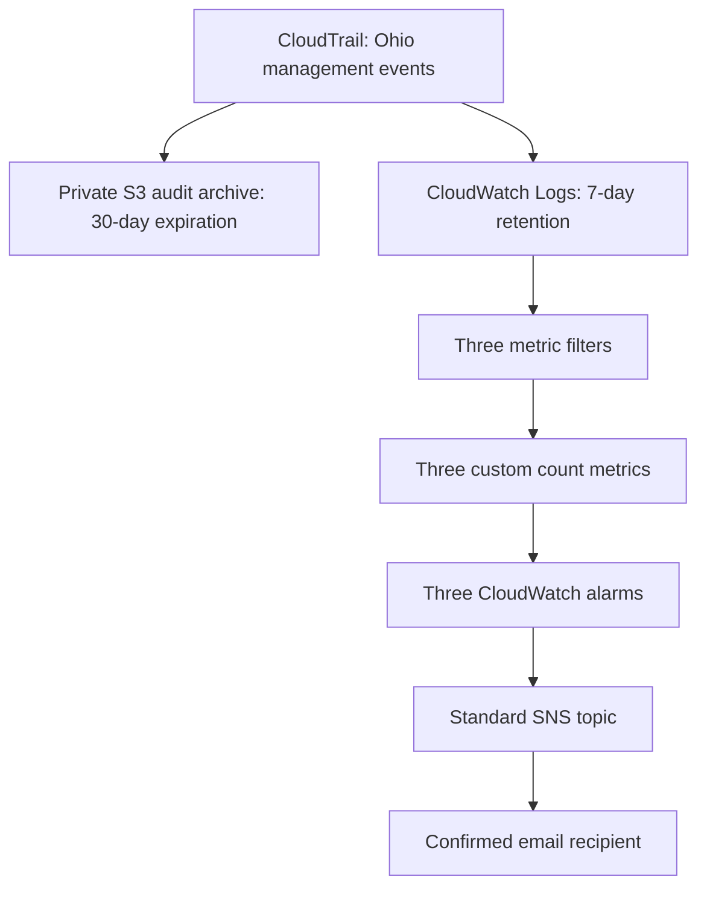
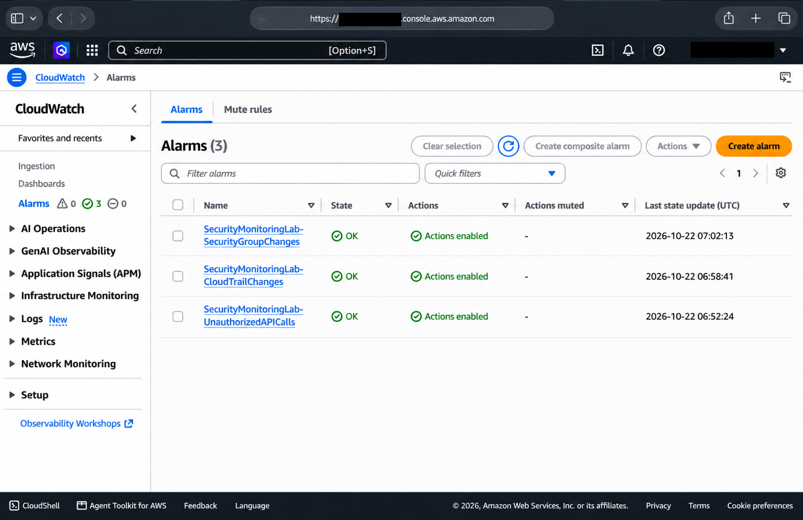
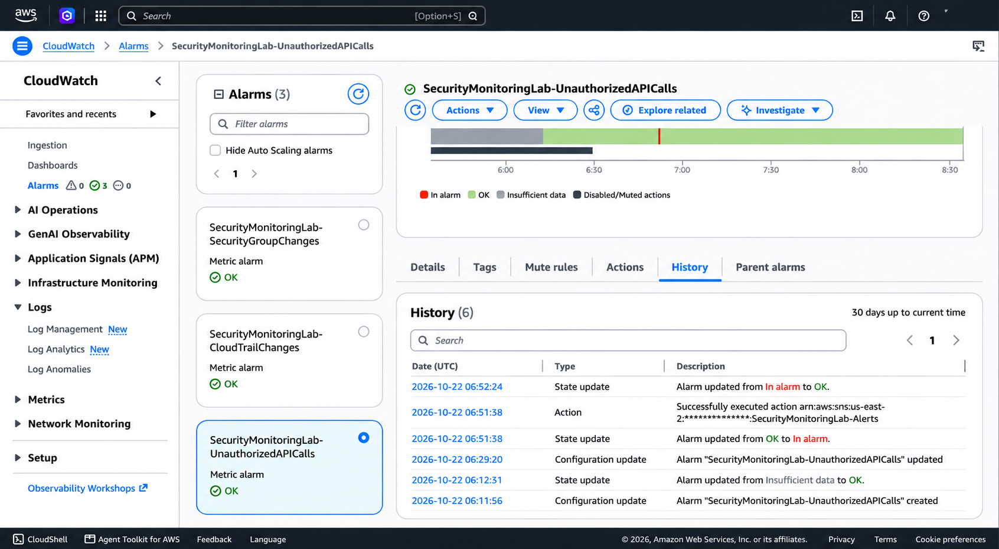

# AWS Security Monitoring Lab

A personal cloud-security learning lab built to collect AWS audit events, detect selected security-relevant activity, and deliver email alerts. The implementation uses AWS CloudTrail, Amazon S3, Amazon CloudWatch, IAM, and Amazon SNS in **us-east-2 (Ohio)**.

Phases 1–6 are complete: logging, three detections, notification configuration, and controlled validation are documented.

## Objective

Connect audit logging, detection logic, and email alerts for selected AWS management activity, emphasizing least privilege, reviewable evidence, safe testing, and a small budget.

## Architecture

CloudTrail uses a dedicated IAM role for Logs delivery and a separate bucket policy for S3 delivery.

## AWS Services Used

| Service | Purpose |
| --- | --- |
| AWS CloudTrail | Record read and write management events in Ohio; generate integrity digests |
| Amazon S3 | Store encrypted audit logs with lifecycle expiration |
| Amazon CloudWatch Logs | Retain events and apply JSON metric filter patterns |
| Amazon CloudWatch | Publish custom metrics, evaluate thresholds, and record alarm history |
| AWS IAM | Restrict CloudTrail's delivery permissions |
| Amazon SNS | Deliver alarm notifications to a confirmed email subscription |

## Security Controls

- The audit bucket blocks all public access, enforces bucket ownership with ACLs disabled, uses SSE-S3 encryption, and requires HTTPS.
- Its delivery policy restricts CloudTrail to the intended project, trail, and log prefix. Audit objects expire after 30 days; the bucket is unversioned.
- The CloudTrail service role permits only log-stream creation and event delivery within the lab's stream prefix, with source restrictions in its trust policy.
- CloudTrail log file integrity validation is enabled. CloudWatch Logs retention is seven days.
- The SNS policy restricts CloudWatch publishing to the three lab alarms and intended project. Email confirmation and HTTPS client restrictions are configured.
- Alarm actions contain only SNS publishing. No automated remediation is configured.

## Detections and Thresholds

| Detection | Events counted | Alarm threshold |
| --- | --- | --- |
| Authorization failures | Errors matching `*UnauthorizedOperation` or `AccessDenied*` | Sum ≥ 3 in five minutes |
| CloudTrail changes | Successful `StopLogging`, `DeleteTrail`, `UpdateTrail`, `PutEventSelectors`, or `PutInsightSelectors` calls | Sum ≥ 1 in five minutes |
| Security-group changes | Successful ingress/egress authorization or revocation, or `ModifySecurityGroupRules` calls | Sum ≥ 1 in five minutes |

All filters require Ohio events. Each publishes a dimensionless `Count` metric in `SecurityMonitoringLab`: 1 per match, default 0 during ingestion without matches. Alarms require one breaching 300-second period and treat missing data as nonbreaching.

Matches warrant review; permission mistakes, authorized administration, and legitimate rule tightening also match.

## Alerting Workflow

CloudTrail delivers events to CloudWatch Logs. Metric filters count JSON matches into custom metrics; alarms evaluate their sums. On transition into `ALARM`, CloudWatch publishes to `SecurityMonitoringLab-Alerts`, and SNS emails the recipient. Remaining in `ALARM` does not repeat notifications. OK and insufficient-data action lists are empty.

## Validation Results

Filter matching and notification delivery were tested separately:

- **12/12 synthetic filter cases passed:** six positive samples matched and six negative samples did not. `TestMetricFilter` evaluated samples without inserting them into the live log group or publishing artificial metric datapoints.
- **Three controlled notification tests succeeded:** `SetAlarmState` temporarily set each alarm to `ALARM` with a controlled-test reason. History recorded successful SNS actions; the recipient confirmed all three emails.
- All alarms returned naturally to `OK` through normal metric evaluation, without being manually forced back.

| Alarm | Approximate natural recovery |
| --- | --- |
| UnauthorizedAPICalls | 46 seconds |
| CloudTrailChanges | 69 seconds |
| SecurityGroupChanges | 86 seconds |

Final checks confirmed active logging, successful delivery without reported errors, unchanged configurations, and all alarms in `OK`.

*Deployment state at capture time; the listed state-update times correspond to the documented recoveries.*

*Historical controlled test: notification at 06:51:38 UTC and natural recovery at 06:52:24 UTC, approximately 46 seconds later.*

Additional evidence: [active CloudTrail logging](docs/evidence/01-cloudtrail-active-logging.png), [deployed authorization filter](docs/evidence/03-authorization-filter-configuration.png), and [received SNS test email](docs/evidence/05-sns-test-email-received.png). The [evidence index](docs/evidence/README.md) provides captions, privacy-review notes, and interpretation limits for all five screenshots.

## Skills Demonstrated

Cloud audit logging; least-privilege service permissions; secure object storage; JSON detection patterns; metric and alarm evaluation; SNS integration; positive/negative testing; evidence interpretation; cost awareness; and Git-based technical documentation.

## Known Limitations and Testing Disclaimer

This is a learning lab, not a production SOC. The single-Region trail excludes global-service and data-event coverage. Delivery delays affect alert timing, and nonbreaching missing-data treatment does not establish pipeline health. Integrity digests are enabled, but digest-chain cryptographic verification was not performed. SNS server-side encryption is not configured.

Controlled tests validated filter matching and alarm-to-SNS-to-email delivery separately. They did **not** prove a complete real security-event-to-email sequence or generate real unauthorized activity, CloudTrail changes, or security-group changes.

All three alarm descriptions still contain the stale text “No notification or remediation actions” despite enabled SNS notifications. This metadata debt remains unresolved; actual notification settings were verified and tested.

## Cost Awareness

The planning estimate is approximately **$1.20/month** for three custom metrics and three standard alarms before allowances or credits, plus variable log storage, ingestion, requests, and minimal SNS usage. This is not measured monthly spending. The configured **$2 monthly budget** is a monitoring safeguard, not a hard spending cap.

## Repository Documentation

[LAB_PLAN.md](LAB_PLAN.md) contains implementation history, exact patterns, validation evidence, and limitations.

[docs/evidence/README.md](docs/evidence/README.md) explains the deployment and controlled-test screenshots and their evidence limits.

## Future Improvements

Proposed, not implemented: sanitized policy examples, an investigation runbook, reproducible deployment instructions, and corrected alarm descriptions. Further AWS changes or real-event tests require separate review.
